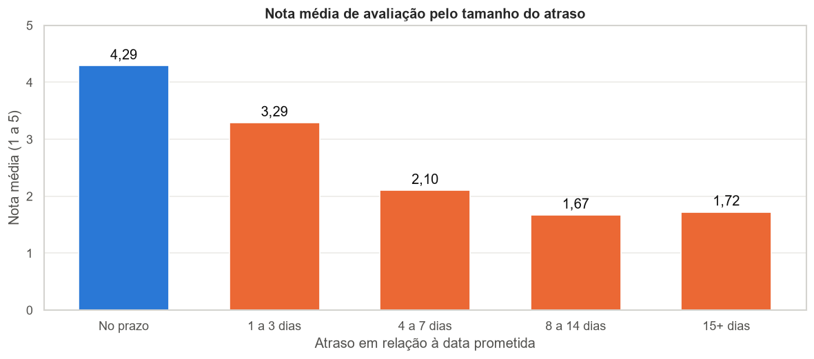
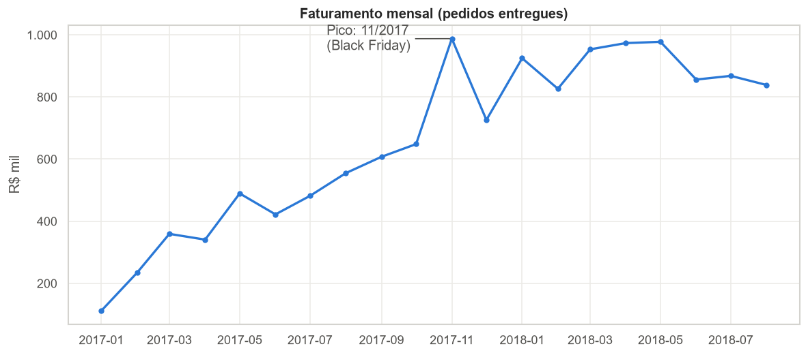
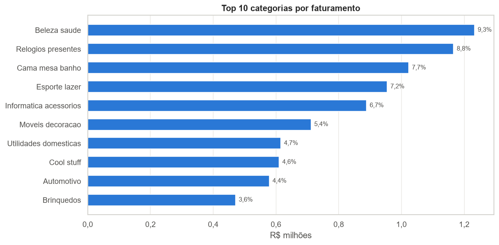
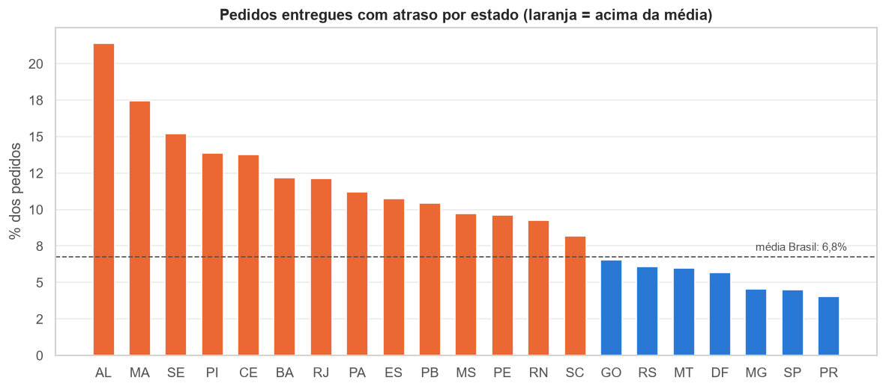

# E-commerce Olist: Vendas, Entregas e Satisfação do Cliente

**Análise Exploratória em Python + Dashboard em Power BI** sobre cerca de 100 mil pedidos reais de e-commerce brasileiro (Olist, 2016–2018).

   

> **Pergunta central:** o atraso na entrega derruba a satisfação do cliente? E onde vale a pena agir primeiro?

---

## 📌 Principais resultados

- **Atraso derruba a nota:** pedidos atrasados recebem nota média **2,27**, contra **4,29** dos entregues no prazo. Com só **1 a 3 dias** de atraso, a nota já cai para 3,29.
- **Poucos atrasos, muitas reclamações:** os atrasados são **7%** dos pedidos avaliados, mas respondem por **32% de todas as avaliações negativas** (notas 1 e 2).
- **Onde agir primeiro:** o Nordeste tem as maiores taxas de atraso (AL 21%, MA 17%). O **RJ**, segundo maior mercado, atrasa **12%** dos pedidos, quase 3 vezes mais que SP (4,5%) e MG (4,6%).
- **Crescimento:** o faturamento de jan a ago de 2018 foi **141% maior** que no mesmo período de 2017, com pico na Black Friday de nov/2017.



---

## 🐍 Análise em Python

O notebook [`analise_exploratoria_olist.ipynb`](analise_exploratoria_olist.ipynb) está **executado**, com todas as tabelas e gráficos visíveis direto no GitHub. Ele segue 5 perguntas de negócio:

| # | Pergunta | Resposta curta |
| :---: | --- | --- |
| 1 | Como o faturamento evoluiu? | Cresceu 141% (jan–ago 2018 vs 2017) e se estabilizou perto de R$ 900 mil/mês em 2018. |
| 2 | Quais categorias concentram a receita? | As 10 maiores (de 74) somam 62%, lideradas por beleza e saúde, relógios e cama, mesa e banho. |
| 3 | Onde a entrega é mais lenta e mais atrasa? | Mediana de 7 dias em SP contra 22 em AL; 6,8% dos pedidos atrasam no país. |
| 4 | O atraso derruba a satisfação? | Sim: nota 2,3 contra 4,3, e 62% de avaliações negativas contra 9%. |
| 5 | Como os clientes pagam? | 78% do valor é pago no cartão de crédito, e 2 em cada 3 compras no cartão são parceladas. |

**O que o notebook mostra de técnica:**

- **Qualidade dos dados:** checagem de nulos, duplicados e status, com cada decisão de tratamento explicada (por exemplo, 551 pedidos com mais de uma avaliação, dos quais fica só a mais recente).
- **Junção de 6 tabelas** relacionais (pedidos, itens, produtos, clientes, avaliações e pagamentos) em uma base por pedido e outra por item.
- **Engenharia de atributos:** tempo de entrega, dias de atraso em relação à data prometida e faixas de atraso.
- **Estatística descritiva e correlação:** média contra mediana para ticket com cauda longa, e correlação de Pearson (frete × peso = 0,61).
- **Leitura crítica:** meses incompletos excluídos da tendência, estados com poucos pedidos fora do ranking e a diferença entre associação e causa.

### Faturamento mensal

O faturamento mais que dobrou ao longo de 2017, teve o pico na Black Friday e se estabilizou em 2018.



### Categorias que concentram a receita



### Atraso nas entregas por estado

Em laranja, os estados acima da média nacional de 6,8% de pedidos atrasados.



---

## 🖥️ Dashboard em Power BI

O arquivo [`dashboard_ecommerce_olist.pbix`](dashboard_ecommerce_olist.pbix) usa modelagem dimensional (**Star Schema**), tratamento no **Power Query** e medidas em **DAX**.

1. **Performance de vendas:** faturamento, pedidos, ticket médio, evolução mensal e top 10 categorias.
2. **Produtos e entregas:** tempo médio de entrega, taxa de atraso por estado e cruzamento de faturamento com prazo por categoria.

Para explorar o dashboard, baixe o arquivo `.pbix` e abra no [Power BI Desktop](https://www.microsoft.com/pt-br/power-platform/products/power-bi/desktop) (gratuito).

---

## 💡 Recomendações

| O que os dados mostram | Recomendação |
| --- | --- |
| Mesmo 1 a 3 dias de atraso já custam 1 ponto na nota | Prometer prazos realistas e avisar o cliente quando houver atraso |
| RJ: alto volume e atraso quase 3 vezes maior que SP | Começar a melhoria logística pelo RJ, onde ela atinge mais clientes |
| Pico de vendas na Black Friday | Planejar estoque e transporte com antecedência para novembro |
| 62% da receita em 10 categorias | Priorizar essas categorias em campanhas e na negociação de frete |

---

## 🔁 Como reproduzir

```bash
git clone https://github.com/iedahirari/dashboard-ecommerce-olist.git
```

```bash
cd dashboard-ecommerce-olist
```

```bash
pip install -r requirements.txt
```

Depois baixe os dados do Kaggle para a pasta `data/` (instruções em [`data/README.md`](data/README.md)) e abra o notebook:

```bash
jupyter notebook analise_exploratoria_olist.ipynb
```

---

## 📁 Estrutura

```text
├── analise_exploratoria_olist.ipynb   <- Análise em Python (executada, com resultados)
├── dashboard_ecommerce_olist.pbix     <- Dashboard do Power BI
├── data/                              <- CSV da Olist (baixar do Kaggle, não versionados)
├── img/                               <- Gráficos exportados pelo notebook
├── requirements.txt                   <- Bibliotecas Python
└── README.md
```

---

## ⚠️ Limitações

- A base pública vai só até agosto de 2018 e não representa toda a operação da Olist.
- Os valores consideram o preço dos produtos dos pedidos entregues, sem descontar devoluções.
- A relação entre atraso e nota é uma **associação**: pedidos atrasados podem ter outros problemas junto (produto errado, avaria) que também derrubam a avaliação.

---

## 📄 Dados e licença

Dados: [Brazilian E-Commerce Public Dataset by Olist](https://www.kaggle.com/datasets/olistbr/brazilian-ecommerce), disponibilizado pela Olist no Kaggle sob a licença [CC BY-NC-SA 4.0](https://creativecommons.org/licenses/by-nc-sa/4.0/). Os dados não fazem parte deste repositório.

O código e a análise deste repositório estão sob a licença do arquivo [`LICENSE`](LICENSE).

---

**Ieda Oliveira** · [Portfólio](https://iedahirari.github.io/portifolio/) · [LinkedIn](https://www.linkedin.com/in/ieda-oliveira/) · [GitHub](https://github.com/iedahirari)
